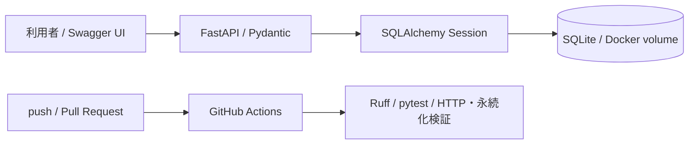

# Request Log — 業務改善リクエスト管理API

[](https://github.com/shogo-ito-4423/request-log-01/actions/workflows/ci.yml)

業務で見つけた改善要望を登録し、担当者・優先度・進捗を管理するREST APIです。
2026年10月12日の1日版MVPとして、要件整理 → API実装 → DB保存 → 自動テスト → CIまでを対象にしています。

開発履歴: [Issue #1](https://github.com/shogo-ito-4423/request-log-01/issues/1) →
`feat/1-minimal-api-ci` → [PR #2](https://github.com/shogo-ito-4423/request-log-01/pull/2)。

## 最短で試す

前提は、起動済みのDocker Engine / Docker DesktopとDocker Compose v2です。
Pythonやライブラリをホストにインストールする必要はありません。

```sh
git clone https://github.com/shogo-ito-4423/request-log-01.git
cd request-log-01
docker compose up --build --detach --wait api
```

- API操作画面（Swagger UI）: <http://localhost:8000/docs>
- OpenAPI仕様: <http://localhost:8000/openapi.json>
- ヘルスチェック: <http://localhost:8000/health>

8000番が使用中の場合は `PORT=18000 docker compose up --build --detach --wait api` を実行し、URLのポートを18000に変更します。
初回ビルドはDocker HubとPyPIへの接続が必要です。Swagger UIも外部CDNを利用します。

## API仕様

| Method | Endpoint | 正常時 | 用途 |
|---|---|---|---|
| GET | `/health` | 200 | DB疎通確認（失敗時503） |
| POST | `/issues` | 201 | 改善要望を登録。Locationヘッダーに詳細URLを返す |
| GET | `/issues?limit=50&offset=0` | 200 | ID昇順の一覧（最大100件） |
| GET | `/issues/{id}` | 200 | 詳細を取得 |
| PATCH | `/issues/{id}` | 200 | 指定したフィールドだけ更新 |

| フィールド | ルール | 作成時の初期値 |
|---|---|---|
| `title` | 必須、前後の空白除去後1〜200文字 | なし |
| `description` | 最大10,000文字 | 空文字 |
| `status` | `open` / `in_progress` / `done` | `open` |
| `priority` | `low` / `medium` / `high` | `medium` |
| `assignee` | 前後の空白除去後1〜100文字、またはnull | null |
| `id` | サーバー採番、変更不可 | 自動 |
| `created_at`, `updated_at` | UTCの日時、変更不可 | 自動 |

存在しないIDは404、不正な入力は422です。未知のフィールドは拒否します。
PATCHは最低1フィールドが必要で、省略フィールドを保持します。
`assignee: null` は担当解除、それ以外のフィールドに明示的なnullは指定できません。
状態遷移の順序制約は設けていません（完了から再オープンも可能）。

## 操作例

以下はデータが空の場合の例です。登録結果の `id` を後続のURLに指定してください。
curlを利用できる環境、または上記Swagger UIで操作できます。

```sh
curl -i http://localhost:8000/health

curl -i -X POST http://localhost:8000/issues \
  -H 'Content-Type: application/json' \
  -d '{"title":"月次集計の転記を自動化したい","description":"毎月の手作業を減らす","priority":"high"}'

curl http://localhost:8000/issues
curl http://localhost:8000/issues/1

curl -X PATCH http://localhost:8000/issues/1 \
  -H 'Content-Type: application/json' \
  -d '{"status":"in_progress","assignee":"担当A"}'

# 異常系: 空白だけのタイトルは422
curl -i -X POST http://localhost:8000/issues \
  -H 'Content-Type: application/json' -d '{"title":" "}'
```

## テスト・静的解析（コンテナ内）

```sh
docker compose --profile test build test
docker compose --profile test run --rm test
```

Ruffの静的解析・整形チェックとpytestを順に実行します。
テストごとに一時ディレクトリにSQLite DBを作るため、APIの保存データには触れません。
アプリのカバレッジ下限は90%です。

主な検証対象は、作成→詳細→一覧→更新の一連の操作、404/422、更新失敗時のデータ保持、
ページ分割、UTC日時、DB障害時の503、アプリ再生成後の永続化です。
GitHub Actionsはpush/PRごとに同じコンテナで検証し、さらに実HTTP通信とAPIコンテナ再作成後のデータ保持を確認します。

## 永続化・停止

SQLiteファイルはコンテナ内の `/data/issues.db` にあり、Dockerの名前付きボリューム `issue-data` に保存されます。

```sh
# 停止・コンテナ削除。DBは保持される
docker compose down

# 再起動して以前の要望を取得できる
docker compose up --detach --wait api
```

`docker compose down --volumes` はDBを含むボリュームを削除します。データを破棄するときだけ使用してください。

## 設計と範囲



- FastAPI: 入力検証とOpenAPIドキュメントをAPI定義と一緒に管理。
- SQLAlchemy: HTTPスキーマとDBモデルを分離し、リクエスト単位でSessionを閉じる。
- SQLite: 1日版のセットアップを小さくし、ファイルDBで永続化を実証。
- Docker: 実行・テスト・依存関係の解決をコンテナ内に統一。非rootユーザーでAPIを実行。
- ロックファイル: 推移的依存関係もバージョンとハッシュを固定。

認証、検索、削除、PostgreSQL、Alembic、クラウドデプロイは後続版の対象です。
この版はローカルデモ用で、Composeでは127.0.0.1にのみポートを公開します。
初期テーブルは起動時に作成しますが、既存テーブルのスキーマ変更には対応しません。
SQLiteの同時書き込み性能と単一プロセス構成を前提としています。

詳しい設計判断と拡張方針は [docs/architecture.md](docs/architecture.md)、
開発・公開の手順は [docs/development.md](docs/development.md) を参照してください。

## 構成

```text
app/                API・入力/出力スキーマ・DBモデル
tests/              独立したSQLite DBによるAPIテスト
scripts/smoke.py     実HTTP通信とコンテナ再作成後の検証
.github/workflows/   コンテナで動くCI
docs/               要件・設計判断・開発手順・検証記録
Dockerfile          runtime / test のマルチステージビルド
compose.yaml        ローカル起動・名前付きボリューム・テスト
requirements*.lock  ハッシュ付き依存関係ロック
```

## 参考資料

- [FastAPI: SQL Databases](https://fastapi.tiangolo.com/tutorial/sql-databases/)
- [GitHub Actions: Pythonのビルドとテスト](https://docs.github.com/en/actions/tutorials/build-and-test-code/python)
