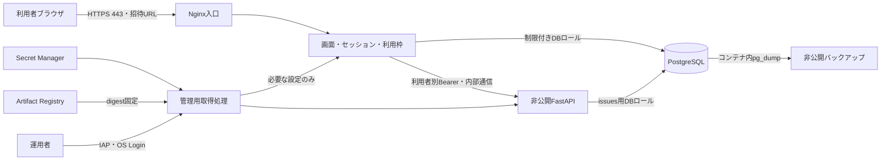

# C2前半：公開環境の設計

対象M3。依存C1（Issue #22、完了）。2026-11-09に選択、11/10に設計文書を完成。
状態：設計を `04768a3` にコミットし、[PR #25](https://github.com/shogo-ito-4423/request-log-01/pull/25)
でマージ済み（`9c850f8`）。Push/PR両CIのpostgresql・test成功を確認。
利用者の明示承認後、[Issue #27](https://github.com/shogo-ito-4423/request-log-01/issues/27)に対応付けた。
コミット後の理解度確認は未実施。
以下のコミット待ちの記載は設計完成時点の状態。
見積もり60〜90分、実績未計測。C2全体の実装・公開完了とは区別する。

## 要件と採用方針

本人の要件：AWSまたはGoogle Cloud、月1,000円、10名、利用者別URLから簡単な画面で
回数上限付きのデモ操作。利用者のネットワークは制限せず、APIはできる限り非公開。
米国リージョン・無料枠は利用可、独自ドメインなし。架空のデモデータを使用する。

Google Compute Engineのus-west1、e2-micro 1台にDocker Composeで入口・画面用サーバー・
既存API・PostgreSQLを配置する設計を選ぶ。単一障害点とOS/DBの自己管理を受け入れる。
10名の登録を想定し、10並列の性能を保証するものではない。負荷試験で不足したら
公開を止め、構成・予算を見直す。無断で上位プランへ変更しない。

「残りタスクを進め、次をコミットにする」依頼に基づき未決事項を以下へ一本化した。
本人が各値を回答・承認したとは記録しない。コミット前にレビュー可能な設計判断であり、
サービス利用・課金リソース作成・公開の承認とは別。

| 項目 | 設計値 |
|---|---|
| 利用資格 | 利用者別のランダム招待URL。初回にセッションへ交換、URLは再利用不可 |
| 期限 | デモ期間の開始から7日。招待・セッションは期間終了まで。再発行で延長しない |
| 個別上限 | 同期間100回／人。再発行でも使用回数を保持 |
| 全体上限 | 同期間の全利用者で1,000回。新期間は管理者の明示操作で作る |
| 回数対象 | 一覧・詳細・登録・更新・削除の内部API呼び出しを各1回 |
| 非対象 | 静的画面・残回数表示・招待交換・内部ヘルス。別途頻度制限 |
| 所有権 | C1を維持：全件閲覧、自分の要望の変更、管理担当者は全件操作 |
| 画面 | 一覧・登録・詳細／更新・削除確認・残回数・期限。外部CDNなし |

値はサーバー設定として変更でき、ブラウザから変更させない。
URLは本人認証ではなく所持を利用資格とする。転送先が先に使える性質があるため、
実業務データや強い本人確認が必要なら別Issueで認証方式を見直す。

## 候補比較

公式料金は2026-11-09〜10確認。試用クレジットを継続運用の前提にしない。

| 候補 | 比較・選択理由 |
|---|---|
| Compute Engineに同居（採用） | 米国e2-micro・標準ディスク無料枠を利用。API/DBはVM内部、秘密はSecret Manager、IP証明書でHTTPS。既存Composeを活用でき低予算だが、OS/DB保守と単一障害点を受け入れる |
| Lightsailに同居 | IPv4付き512MBは月$5、1GBは$7。前者のメモリ余裕は未検証、後者は追加費用前から予算が厳しい。AWS学習へ直結する利点はあるが今回は見送る |
| Cloud Run＋Cloud SQL | HTTPS入口の保守は軽いがDB料金が別途必要。秘密管理と非公開接続も設計が必要で、今回の1,000円予算では優先しない |

M3をGoogle Cloudで完了してもAWSのM4達成とは扱わない。M4への移行時は本環境の
撤収計画で二重課金を避け、IaC・IAM・CloudWatchの条件を別途満たす。

- [Google Cloud無料枠](https://docs.cloud.google.com/free/docs/free-cloud-features)
- [Lightsail料金](https://docs.aws.amazon.com/lightsail/latest/userguide/amazon-lightsail-bundles.html)
- [Cloud Run料金](https://cloud.google.com/run/pricing)／[Cloud SQL料金](https://cloud.google.com/sql/pricing)

## 構成・公開境界

- 標準永続ディスク合計30GB以内。OS用10GB・データ用20GBを分け、データ側はVM削除時の
  自動削除対象から外す。DBの名前付きボリュームはデータディスク上の保存先へ配置する。
- 固定IPv4を1個。利用者向け80/443のみ全ネットワークへ公開。80はACME検証とHTTPS転送だけ。
  APIの8000、DBの5432はpublishしない。
- Dockerネットワークを入口↔画面、画面↔API、アプリ↔DBに分ける。API/DB側はinternal。
  入口をDB網へ接続せず、入口にAPI直通ルート・任意URL転送を設けない。
- APIの/issues・docs/openapi/healthをそのまま外部へ転送しない。公開する画面用操作窓口は
  固定したCRUDだけで、すべてセッション・回数判定を通す。
- 管理SSHはIAP範囲からのみ22番を許可しOS Loginを使用。一般利用者のネットワークは
  制限しない。Dockerソケットをコンテナへマウントしない。
  [IAP管理経路](https://docs.cloud.google.com/iap/docs/using-tcp-forwarding)

## HTTPS・イメージ

NginxとCertbotをコンテナで実行。CertbotはIPアドレスのwebrootに対応する5.4以上の
保守版を選び、実装時に全イメージをdigest固定する。Let's Encryptのshortlived・HTTP-01を
使用し、stagingで到達・更新確認後に信頼される本番証明書へ切り替える。
[IP証明書の公式手順](https://letsencrypt.org/2026/03/11/shorter-certs-certbot.html)

Certbotが証明書・ACME用ボリュームへ書き込み、Nginxはread-onlyで読む。両者だけが
challenge領域を共有する。管理ジョブが6時間ごとにコンテナ内の更新を実行し、
証明書とNginx設定の検査成功後にCompose CLI経由でreloadする。ソケットは渡さない。
残存48時間未満で責任者へ通知。復旧しなければ新規招待を止め、失効前に公開を停止する。
自己署名証明書の警告を無視させる運用はしない。

イメージはus-west1の非公開Artifact Registryへ保存。CIのtest/postgresql成功後、
対象SHAをlinux/amd64でビルドしdigestを記録する。VMでビルドしない。
C2は運用者が承認済みdigestを手動配備し、C3で自動CDへ進む。
現行版・直前正常版・必要な基盤イメージを合計2GiB以内で保持。超過時は整理案をレビューし、
復旧用digestや既存イメージを無断削除しない。

## 秘密管理・権限

Secret Managerにus-west1の単一ロケーションで保存。起動・更新時だけ取得し、version IDを
配備記録へ残す。設定ファイル読込をアプリへ追加し、一時領域の必要なファイルだけを
read-onlyで渡す。秘密を.env・リポジトリ・CIログへ保存しない。ローカル環境変数方式は維持。

| 設定束 | 読むコンテナ | 内容 |
|---|---|---|
| api-config | API | AUTH_USERS_JSONのハッシュ・役割、issues専用DB資格 |
| gateway-config | 画面 | 利用者別内部トークン、招待・セッション・利用枠用DB資格 |
| migration-config | 一時移行ジョブ | DDL専用ロール |
| database-admin | 初期化・管理 | ロール作成・障害対応用。常駐アプリへ渡さない |
| backup-config | バックアップ | 対象表の読み取り専用資格。復元は管理用資格で一時実行 |

原則5束、現行と直前版・予備を含む12active versions以内。disabled版も課金に含める。
破棄は対象を提示して承認を得る。PostgreSQLではPUBLICの不要なCREATE権限を除き、
runtimeへDDLを与えない。APIは招待・利用枠に、画面はissuesに直接DMLできない権限とする。
新テーブルのGRANT漏れも移行試験で検出する。

VM管理処理のサービスアカウントは対象秘密のAccessor、専用レジストリReader、専用
バックアップバケットへの作成権限、ログ送信のWriterを持つ。アプリからmetadataサービスへの通信を
遮断し、VM資格で秘密を取得できないことを検証する。同一VMのroot侵害までは隔離できない。
CI発行者は専用レジストリWriterのみで、配備先秘密を取得しない。GitHub OIDCで
リポジトリ・ブランチ／Environmentを制約し、長期鍵を使わない。
運用者には対象VMのIAPトンネル・OS Login管理権限。初期構築者と分け、Owner/Editorを常用しない。
設定は配備承認後にコンテナ内CLIで行い、手元のOS設定を変更しない。

## 招待・セッション・利用枠

招待秘密は32バイト以上の乱数でDBへハッシュのみ保存。URLフラグメントを同一オリジンJSで
読み、アドレスから除去してPOST本文で交換する。no-referrer・no-store、外部スクリプトなし。
配布メッセージ・初回履歴への残存可能性はある。GETやリンクプレビューでは招待を消費しない。

交換時は期限・失効・使用済みを判定し、消費とセッション登録を1トランザクションで確定。
セッションも乱数をハッシュ保存し、__Host- Cookie（Secure、HttpOnly、SameSite=Strict、
Path=/、Domainなし）で返す。Origin検査とCSRFトークンで状態変更を保護する。
利用者IDはセッションから決め、内部Bearerをブラウザへ返さない。共有管理者資格を使わない。

セッション確認→利用枠commit→内部API最大1回の順。全体・個別カウンターを条件付き更新し、
片側失敗なら両方rollback。上限は429、利用枠DB異常は503で転送しない。
転送エラー・タイムアウト・commit後のプロセス停止も1回消費のまま。自動再試行・ポーリングなし。
無効・使用済み・期限切れ招待は同じ401で秘密や利用者の存在を説明しない。
入口のPOST本文は32KiB以下。招待交換は送信元ごと毎分5回・burst 5、操作は利用者ごと
毎分30回・burst 5を初期値とする。一時的な負荷対策であり、永続的な100回上限とは別。

## 費用・運用・検証

[運用・費用・検証計画](cloud-demo-operations.md)に、料金内訳と配備前条件、移行、
招待配布・失効、バックアップ・復旧・撤収、手順と期待値を持つ検証表を定義した。

## 設計の完了判定

| 当初の条件 | 証跡・判定 |
|---|---|
| 利用条件・予算・公開範囲 | 設計完了。本書の要件・設計値 |
| 候補比較と公式情報 | 設計完了。比較表・出典・運用文書の費用表 |
| 配置・通信・秘密・イメージ | 設計完了。構成図・公開境界・権限 |
| 移行・失敗停止・配布・失効 | 設計完了。運用文書の手順 |
| 検証手順と期待結果 | 設計完了。運用文書の受入検証表 |
| 権限・費用・撤収をレビュー可能 | 設計完了。権限分担・費用内訳・配備前条件・撤収手順 |

実アカウントの無料枠残量・権限と実環境動作は未検証。配備前の担当・確認方法を明記し、
確認済みとは扱わない。設計文書の残作業はなく、次は差分承認・コミット。課金・公開は行わない。
コミット後は実差分でA・B・Cを1問ずつ確認する。今回確認できたのは画面側制限を回避できる
理由であり、全設計を理解済みとは扱わない。

後続は[C2a文案](issue-demo-quota.md)の利用枠→招待・セッション→転送→画面。
C2e-1は設計のやり直しではなく、実装後の寸法・費用・権限・証跡の実照合。
C2e-2の配備・実検証後にC2全体を完了し、C3のCD・C4の復旧演習へ進む。
当初期限は保持し、C2aの実績後に後続日程を見直す。
